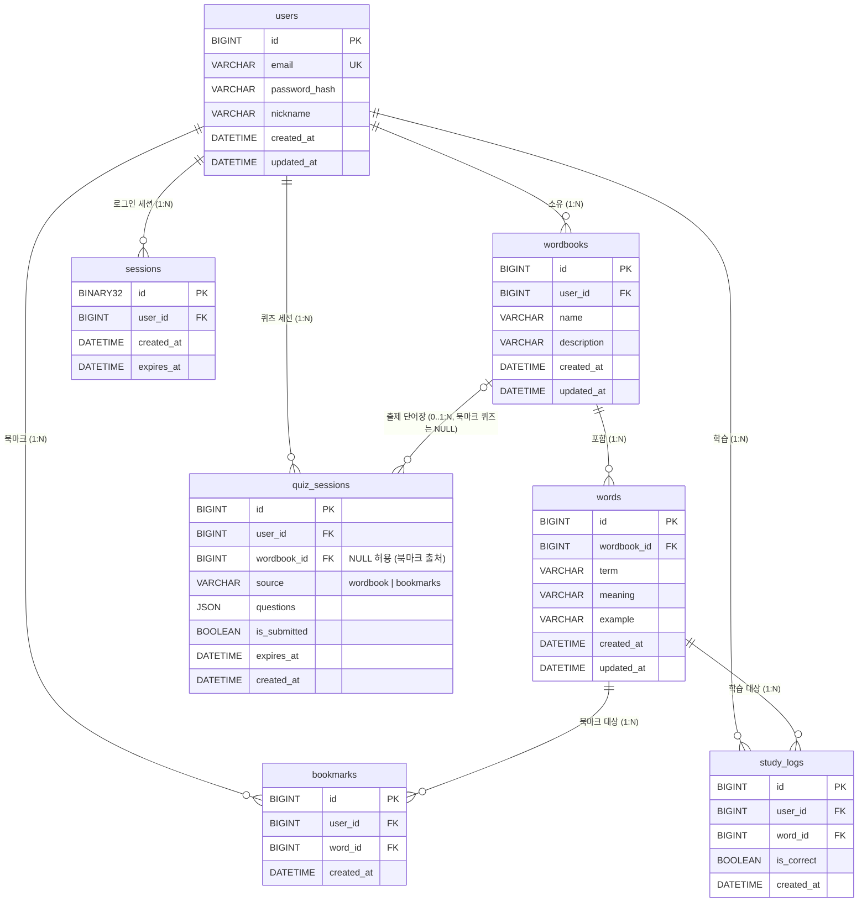

# 데이터 설계서 (Data Design)

| 항목 | 내용 |
| :--- | :--- |
| 프로젝트 | voda-voca (보다보카) |
| 문서 종류 | Data Design (`개발방법론.md` §2.3, 필수 산출물) |
| 기준 문서 | `docs/voda-voca_Requirement_Spec_v1.2_261102.md` (REQ-003, 004, 005, 007, 008, 009, 016, 017, 018, 102~109) |
| 버전 / 상태 | v1.2 / **승인 (Approved)** |
| 작성일 | 2026-11-02 |
| DBMS | MySQL 8.0 (Docker 컨테이너, `docker/docker-compose.yml`) |
| 엔진 / 문자셋 | InnoDB / `utf8mb4` / `utf8mb4_0900_ai_ci` |
| 산출물 경로 | `docs/voda-voca_Data_Design_v1.2_261102.md` (이전 버전: `docs/old/voda-voca_Data_Design_v1.1_261102.md`, `docs/old/voda-voca_Data_Design_v1.0_261102.md`) |
| 관련 결정 | `ai-agent/claude/검토_261102_ADR_핵심아키텍처결정.md` (ADR-001 세션, ADR-002 bcrypt, ADR-003 검색) |

---

## 1. ERD



### 1.1 관계 요약

| 관계 | 카디널리티 | 설명 | 삭제 정책 |
| :--- | :---: | :--- | :--- |
| users → wordbooks | 1:N | 사용자는 여러 단어장을 소유한다. 동일 사용자 내 이름은 중복될 수 없다. | CASCADE |
| wordbooks → words | 1:N | 단어장은 여러 단어를 가진다. 단어는 단어장에 종속된다. | CASCADE |
| users ↔ words (bookmarks) | M:N | 사용자와 단어의 북마크 관계. `bookmarks`가 교차 테이블이다. | CASCADE (양쪽) |
| users ↔ words (study_logs) | M:N | 사용자와 단어의 학습 이력. 문항 답안 1건당 1행으로 누적한다. | CASCADE (양쪽) |
| users → sessions | 1:N | 사용자의 로그인 세션. 로그아웃 또는 계정 삭제 시 정리한다. | CASCADE |
| users → quiz_sessions | 1:N | 사용자의 퀴즈 출제 세션. 제출 여부와 무관하게 보관되며 만료 후에도 행은 남는다. | CASCADE |
| wordbooks → quiz_sessions | 1:N (선택) | 단어장 출처 세션의 원천 단어장. 북마크 출처 세션은 NULL이다. | CASCADE |

---

## 2. 공통 규칙

### 2.1 문자셋 및 콜레이션 (REQ-108)
- 모든 테이블: `ENGINE=InnoDB DEFAULT CHARSET=utf8mb4 COLLATE=utf8mb4_0900_ai_ci`
- 컬럼 단위 문자셋 지정은 하지 않는다 (테이블 기본값 상속).
- **대소문자·악센트 정책**: `utf8mb4_0900_ai_ci`는 대소문자를 구분하지 않고, 악센트도 구분하지 않는다 (`ai`). 따라서 `words(wordbook_id, term)` UNIQUE는 `Apple`과 `apple`을 같은 표제어로 보며, `café`와 `cafe`도 같은 표제어로 본다. 이는 의도된 동작이다 (D2 확정).
- 이모지와 한글 저장을 위해 `utf8mb4`를 강제하며, `utf8` (utf8mb3)은 사용하지 않는다.
- **서버 기본값 정합**: 현재 `docker/docker-compose.yml`의 `--collation-server=utf8mb4_unicode_ci`는 본 설계와 다르다. 테이블은 명시적으로 `COLLATE=utf8mb4_0900_ai_ci`를 지정하므로 DDL 결과는 일치하지만, 서버 기본값도 맞추려면 컨테이너 재생성이 필요하다 (§6 F1).

### 2.2 시간대 정책 (REQ-108, REQ-109)
| 구분 | 정책 |
| :--- | :--- |
| 저장 값 | 모든 `DATETIME(3)` 컬럼은 **UTC**로 저장한다. |
| 기본값 | `DEFAULT (UTC_TIMESTAMP(3))` 을 사용한다. `NOW()`나 `CURRENT_TIMESTAMP`는 세션 시간대(+09:00)의 영향을 받으므로 쓰지 않는다. |
| 세션 시간대 | 컨테이너 설정 `--default-time-zone=+09:00`을 유지한다. 세션 값은 `NOW()` 같은 함수 결과에만 영향을 주며, 설계상 저장 기준으로 쓰지 않는다. |
| 표시 | 응답 직렬화 시 UTC를 Asia/Seoul(KST)로 변환한다. 변환은 프론트엔드 표시 단계에서 수행한다 (REQ-109 확정). |
| 타입 선택 | `TIMESTAMP`(자동 UTC 변환, 2038년 문제)를 쓰지 않고 `DATETIME(3)`을 쓴다. 밀리초 정밀도를 유지한다. |

> **근거**: `TIMESTAMP`는 세션 시간대에 따라 입출력 값이 달라지므로, 시간대 설정이 바뀌면 같은 행의 값이 다르게 보이는 문제가 생긴다. UTC 값을 `DATETIME`에 명시적으로 저장하면 설정 변경과 무관하게 값이 고정된다.

### 2.3 기본 키 및 공통 컬럼
- PK: `id BIGINT UNSIGNED AUTO_INCREMENT`. 행 수 증가에 대비해 INT가 아닌 BIGINT를 쓴다.
- 생성/수정 시각: `created_at`, `updated_at` (`DATETIME(3)`, UTC). 생성 시각은 `DEFAULT (UTC_TIMESTAMP(3))`로 채운다.
- 수정 시각 `updated_at`은 DB의 `ON UPDATE`절로 갱신하지 않는다. MySQL의 `ON UPDATE`는 `CURRENT_TIMESTAMP` 계열만 허용하며 `UTC_TIMESTAMP`는 쓸 수 없다. 대신 애플리케이션 계층(SQLAlchemy `onupdate`)에서 UTC 시각을 명시적으로 설정한다.
- 소프트 삭제 컬럼(`deleted_at`)은 두지 않는다. 삭제 정책은 하드 삭제다 (REQ-007 확정).

### 2.4 삭제 연쇄 (REQ-104, REQ-007)
- 모든 FK는 `ON DELETE CASCADE`로 정의한다.
- 단어장 삭제 시 단어, 그 단어의 북마크와 학습 이력이 함께 삭제된다. 이 연쇄는 REQ-007, REQ-011을 DB 수준에서 보장한다.
- 단어 삭제 시 북마크와 학습 이력이 함께 삭제된다 (REQ-011).
- 학습 이력은 삭제 후에도 보존하지 않는다 (하드 삭제 정책과 일관).
- 계정 삭제 시 `sessions` 행도 함께 삭제되어 해당 계정의 모든 로그인이 즉시 무효화된다.
- 계정 삭제 시 `quiz_sessions` 행도 함께 삭제된다 (`fk_quiz_sessions_user`).
- 단어장 삭제 시 그 단어장을 출처로 한 `quiz_sessions` 행도 함께 삭제된다 (`fk_quiz_sessions_wordbook`).
- **단어 삭제는 퀴즈 세션을 삭제하지 않는다.** 문항 정보가 `questions` JSON에 들어 있어 `quiz_sessions`와 `words` 사이에 FK가 없다. 대신 제출 시점에 문항 단어의 존재를 서비스 계층에서 확인하고, 삭제되었으면 409로 막는다 (§3.5 설계 메모 참조).

### 2.5 검색 정책 (REQ-009)
- 표제어 검색은 **접두사 일치**(`term LIKE 'keyword%'`)를 기본으로 한다. 선행 와일드카드(`%keyword%`)는 인덱스를 쓸 수 없으므로 1차에서 사용하지 않는다.
- 검색 범위는 항상 `wordbook_id = ?` 조건을 함께 건다. 이 조건과 `term` 접두사 조건은 `uk_words_wordbook_term (wordbook_id, term)` 인덱스로 처리된다.
- 입력값의 `%`, `_`, `\`는 LIKE 이스케이프 처리하고, 바인딩 파라미터로 전달한다 (REQ-113).
- 뜻(`meaning`) 검색은 1차에서 제외한다 (§6 F4).

---

## 3. 테이블 명세

### 3.1 users (계정) — REQ-001, REQ-002, REQ-003, REQ-110

| 컬럼 | 타입 | NULL | 기본값 | 제약 / 설명 |
| :--- | :--- | :---: | :--- | :--- |
| `id` | BIGINT UNSIGNED | N | AUTO_INCREMENT | **PK** |
| `email` | VARCHAR(255) | N | — | **UNIQUE** (`uk_users_email`). 로그인 아이디. 형식 검증은 Pydantic 계층에서 수행. |
| `password_hash` | VARCHAR(255) | N | — | bcrypt 해시 (REQ-110, ADR-002). 평문 저장 금지. 60자 고정 길이이며 여유를 두어 255로 정의한다. |
| `nickname` | VARCHAR(50) | N | — | 표시 이름. |
| `created_at` | DATETIME(3) | N | `(UTC_TIMESTAMP(3))` | UTC |
| `updated_at` | DATETIME(3) | N | `(UTC_TIMESTAMP(3))` | UTC, 수정 시 앱에서 갱신 |

**인덱스**: `PRIMARY KEY (id)`, `UNIQUE KEY uk_users_email (email)`

**CHECK**: `CHECK (CHAR_LENGTH(TRIM(nickname)) > 0)`

> 로그인 세션은 `sessions` 테이블(§3.6)에 저장한다 (ADR-001).

---

### 3.2 wordbooks (단어장) — REQ-004~007, REQ-003

| 컬럼 | 타입 | NULL | 기본값 | 제약 / 설명 |
| :--- | :--- | :---: | :--- | :--- |
| `id` | BIGINT UNSIGNED | N | AUTO_INCREMENT | **PK** |
| `user_id` | BIGINT UNSIGNED | N | — | **FK** → `users.id` `ON DELETE CASCADE`. 소유자 (REQ-003). |
| `name` | VARCHAR(50) | N | — | 단어장 이름 (REQ-004, 1~50자). 사용자 내 유일 (D1). |
| `description` | VARCHAR(200) | Y | NULL | 설명 (REQ-004, 0~200자). |
| `created_at` | DATETIME(3) | N | `(UTC_TIMESTAMP(3))` | UTC |
| `updated_at` | DATETIME(3) | N | `(UTC_TIMESTAMP(3))` | UTC, 수정 시 앱에서 갱신. 목록 정렬 기준 (REQ-005). |

**인덱스**
- `PRIMARY KEY (id)`
- `UNIQUE KEY uk_wordbooks_user_name (user_id, name)`: 동일 사용자의 단어장 이름 중복 방지 (D1, REQ-105). `user_id` 단독 인덱스를 대체한다.
- `KEY idx_wordbooks_user_updated (user_id, updated_at)`: 본인 단어장을 최근 수정순으로 조회하는 REQ-005 쿼리를 커버한다.

**CHECK**: `CHECK (CHAR_LENGTH(TRIM(name)) > 0)`

**관계**: `users` 1 : N `wordbooks`

**설계 메모**
- 이름 중복 판정은 `utf8mb4_0900_ai_ci` 기준이므로 `Vocab`과 `vocab`은 같은 이름으로 본다.
- 이름 중복 시 서비스 계층에서 먼저 검사해 사용자에게 명확한 오류를 반환하고, DB UNIQUE는 동시 요청에 대한 최종 방어선이다.

---

### 3.3 words (단어) — REQ-008~011, REQ-105

| 컬럼 | 타입 | NULL | 기본값 | 제약 / 설명 |
| :--- | :--- | :---: | :--- | :--- |
| `id` | BIGINT UNSIGNED | N | AUTO_INCREMENT | **PK** |
| `wordbook_id` | BIGINT UNSIGNED | N | — | **FK** → `wordbooks.id` `ON DELETE CASCADE` |
| `term` | VARCHAR(100) | N | — | 표제어 (REQ-008, 1~100자). |
| `meaning` | VARCHAR(200) | N | — | 뜻 (REQ-008, 1~200자). |
| `example` | VARCHAR(500) | Y | NULL | 예문 (REQ-008, 0~500자). |
| `created_at` | DATETIME(3) | N | `(UTC_TIMESTAMP(3))` | UTC |
| `updated_at` | DATETIME(3) | N | `(UTC_TIMESTAMP(3))` | UTC, 수정 시 앱에서 갱신 |

**인덱스**
- `PRIMARY KEY (id)`
- `UNIQUE KEY uk_words_wordbook_term (wordbook_id, term)`: 동일 단어장 내 표제어 중복 방지 (REQ-105). 접두사 검색(§2.5)의 인덱스 역할도 겸한다.

**CHECK**: `CHECK (CHAR_LENGTH(TRIM(term)) > 0 AND CHAR_LENGTH(TRIM(meaning)) > 0)`

**관계**: `wordbooks` 1 : N `words`

**설계 메모**
- 목록 조회는 페이지 크기 20의 OFFSET 페이징을 기본으로 한다 (REQ-005, REQ-009 확정). 단어 1,000개 규모에서 OFFSET 비용은 무시할 수준이므로 keyset 페이징은 도입하지 않는다.
- `words`에는 `user_id`를 두지 않는다. 소유권은 `wordbooks.user_id`를 통해 판정한다 (정규화 유지). REQ-003 검증은 서비스 계층에서 단어장 소유자를 먼저 확인하는 방식으로 수행한다.

---

### 3.4 bookmarks (북마크) — REQ-017, REQ-018, REQ-105

| 컬럼 | 타입 | NULL | 기본값 | 제약 / 설명 |
| :--- | :--- | :---: | :--- | :--- |
| `id` | BIGINT UNSIGNED | N | AUTO_INCREMENT | **PK** |
| `user_id` | BIGINT UNSIGNED | N | — | **FK** → `users.id` `ON DELETE CASCADE` |
| `word_id` | BIGINT UNSIGNED | N | — | **FK** → `words.id` `ON DELETE CASCADE` |
| `created_at` | DATETIME(3) | N | `(UTC_TIMESTAMP(3))` | UTC. 북마크 등록 시각. |

**인덱스**
- `PRIMARY KEY (id)`
- `UNIQUE KEY uk_bookmarks_user_word (user_id, word_id)`: 같은 단어에 중복 북마크 방지 (REQ-017, REQ-105). `user_id` 단독 인덱스를 대체한다.
- `KEY idx_bookmarks_word (word_id)`: 단어 삭제 시 CASCADE 검색 및 역방향 조회용 (명시적으로 기술).

**관계**: `users` 1 : N `bookmarks` N : 1 `words`

**설계 메모**
- 북마크 목록 (REQ-018)은 `bookmarks` → `words` → `wordbooks`를 조인하여 단어장 이름을 함께 반환한다. 조인 키는 PK와 FK이므로 추가 인덱스는 필요 없다.
- **소유권 검증 (D3 확정)**: `bookmarks.user_id`와 `words`의 소유자 일치는 DB 복합 FK로 강제하지 않는다. 북마크 등록 시 서비스 계층이 `words.wordbook_id → wordbooks.user_id == 요청 사용자`를 반드시 검증한다. 검증 실패 시 404로 응답한다 (REQ-003).

---

### 3.5 study_logs (학습 이력) — REQ-016 (S)

문항 답안 1건당 1행을 저장한다. 단어별 누적 카운터는 두지 않는다 (REQ-016 확정).

| 컬럼 | 타입 | NULL | 기본값 | 제약 / 설명 |
| :--- | :--- | :---: | :--- | :--- |
| `id` | BIGINT UNSIGNED | N | AUTO_INCREMENT | **PK** |
| `user_id` | BIGINT UNSIGNED | N | — | **FK** → `users.id` `ON DELETE CASCADE` |
| `word_id` | BIGINT UNSIGNED | N | — | **FK** → `words.id` `ON DELETE CASCADE` |
| `is_correct` | BOOLEAN | N | — | 해당 문항 정답 여부 (`TINYINT(1)`). 정답 1, 오답 0. |
| `created_at` | DATETIME(3) | N | `(UTC_TIMESTAMP(3))` | UTC. 답안 제출 시각. 최신순 정렬 기준. |

**인덱스**
- `PRIMARY KEY (id)`
- `KEY idx_study_logs_user_created (user_id, created_at)`: 사용자별 최근 학습 이력 조회 (D4 확정). 쿼리는 `ORDER BY created_at DESC, id DESC`로 정렬하며, 인덱스를 역방향으로 읽는다.
- `KEY idx_study_logs_word (word_id)`: 단어 삭제 시 CASCADE 검색용 (명시적으로 기술).

**CHECK**: 없음 (`is_correct`는 BOOLEAN으로 값 범위가 보장됨).

**관계**: `users` 1 : N `study_logs` N : 1 `words`

**설계 메모**
- **최근 학습 목록 쿼리 (REQ-016)**: 기본 형태는 `WHERE user_id = ? ORDER BY created_at DESC, id DESC LIMIT 100`이다. 동적 쿼리로 `word_id` 또는 기간 조건을 선택적으로 추가할 수 있으며, 조건 추가 시에도 `user_id` 선두 인덱스를 사용한다. 별도 역정규화 컬럼은 두지 않는다 (D4).
- **기록 방식**: 퀴즈 제출 시 문항 수만큼 INSERT를 한 트랜잭션으로 묶어 저장한다 (REQ-106). 부분 저장을 막는다.
- **단어 삭제와의 상호작용**: 제출 시 세션 문항의 단어 ID 전체가 `words`에 존재하는지 먼저 확인한다. 하나라도 없으면 아무 행도 쓰지 않고 409를 반환한다. 확인과 커밋 사이의 경쟁으로 FK가 깨지는 경우도 같은 409로 바꾼다.
- **동시 제출 방어**: 제출은 `quiz_sessions` 행을 `SELECT ... FOR UPDATE`로 잠근 뒤, 세션 갱신과 이력 INSERT를 한 트랜잭션으로 커밋한다 (REQ-106).
- `user_id`는 `words → wordbooks → user_id`로 유도할 수 있지만, 조회 단순화를 위해 중복 저장한다. 두 값의 일치는 서비스 계층에서 보장한다.
- **보존 기간**: 1차에서는 삭제 정책을 두지 않는다. 행 증가량은 사용자 수 × 퀴즈 문항 수에 비례하며, 필요 시 후속 작업으로 기간 기반 정리를 검토한다.

### 3.6 sessions (로그인 세션) — REQ-001, REQ-002

세션 쿠키 인증(REQ-001 확정)의 서버 측 저장소다 (ADR-001). 클라이언트 쿠키에는 무작위 토큰 원문을 두고, DB에는 그 토큰의 SHA-256 다이제스트만 저장한다. DB가 노출되어도 유효한 세션 토큰이 노출되지 않도록 하기 위함이다.

| 컬럼 | 타입 | NULL | 기본값 | 제약 / 설명 |
| :--- | :--- | :---: | :--- | :--- |
| `id` | BINARY(32) | N | — | **PK**. 세션 토큰의 SHA-256 다이제스트(원문 32바이트). 쿠키 원문은 저장하지 않는다. |
| `user_id` | BIGINT UNSIGNED | N | — | **FK** → `users.id` `ON DELETE CASCADE` |
| `created_at` | DATETIME(3) | N | `(UTC_TIMESTAMP(3))` | UTC. 로그인 시각. |
| `expires_at` | DATETIME(3) | N | — | UTC. 만료 시각. 기본 수명은 로그인 후 14일이다 (절대 만료, 슬라이딩 연장 없음). |

**인덱스**
- `PRIMARY KEY (id)`
- `KEY idx_sessions_user (user_id)`: 사용자별 세션 일괄 삭제(계정 삭제·전체 로그아웃)용.
- `KEY idx_sessions_expires (expires_at)`: 만료 세션 정리 작업용.

**설계 메모**
- **ORM 매핑**: 테이블 이름은 `sessions`이고, ORM 클래스는 `AuthSession`이다. SQLAlchemy의 `Session`과 이름이 겹치는 것을 피하기 위함이다 (`src/backend/models/session.py`). 설계서와 DDL에서는 테이블 이름 `sessions`를 쓰고, 코드에서는 `AuthSession`을 쓴다.
- 인증 시 `WHERE id = ? AND expires_at > UTC_TIMESTAMP(3)`으로 조회한다. 만료 세션은 조회되지 않는다.
- 로그아웃은 해당 행을 삭제한다 (REQ-002). 삭제 후에는 같은 쿠키로 접근할 수 없다.
- 만료된 행의 물리 삭제 작업은 1차에서 필요하지 않으나, 행이 누적되면 `idx_sessions_expires`로 배치 삭제한다.
- 쿠키 속성(`HttpOnly`, `SameSite=Lax`, `Secure`)은 `.env`에서 주입한다 (REQ-112). `Secure`는 HTTPS 환경에서만 켠다.

---

### 3.7 quiz_sessions (퀴즈 세션) — REQ-014, REQ-015, REQ-016, REQ-106

퀴즈 출제 1회분의 서버 측 상태다. 정답 인덱스는 클라이언트에 보내지 않고 이 테이블의 `questions`에만 보관한다 (REQ-014). 세션은 출제 후 30분 뒤 만료되며, 제출은 한 번만 가능하다 (REQ-016, REQ-106). 결정 근거는 §6.1 D6~D8이다.

| 컬럼 | 타입 | NULL | 기본값 | 제약 / 설명 |
| :--- | :--- | :---: | :--- | :--- |
| `id` | BIGINT UNSIGNED | N | AUTO_INCREMENT | **PK** |
| `user_id` | BIGINT UNSIGNED | N | — | **FK** → `users.id` `ON DELETE CASCADE`. 세션 소유자. |
| `wordbook_id` | BIGINT UNSIGNED | Y | NULL | **FK** → `wordbooks.id` `ON DELETE CASCADE`. `source='wordbook'`일 때 원천 단어장. 북마크 출처면 NULL. |
| `source` | VARCHAR(16) | N | — | `'wordbook'` 또는 `'bookmarks'` (`CHECK`). |
| `questions` | JSON | N | — | 문항 배열. 아래 구조 참조. |
| `is_submitted` | BOOLEAN | N | — | 제출 성공 시 `TRUE`. 재제출을 막는 기준이다. |
| `expires_at` | DATETIME(3) | N | — | UTC. 출제 시각 + 30분. 이 시각 이후 제출은 거부한다. |
| `created_at` | DATETIME(3) | N | `(UTC_TIMESTAMP(3))` | UTC. 출제 시각. |

**`questions` JSON 구조** (문항 1건)

```json
{
  "question_id": 0,
  "word_id": 123,
  "term": "apple",
  "choices": ["사과", "배", "포도", "바나나"],
  "correct_index": 0
}
```

- `question_id`는 0부터 시작하는 배열 위치 번호다. 제출 답안은 이 값을 기준으로 맞춘다.
- `correct_index`는 클라이언트 응답에 포함하지 않는다.
- `term`, `choices`, `correct_index`는 채점과 오답 응답에 쓰므로 단어 테이블을 다시 읽지 않아도 된다. 단, `word_id`의 존재는 제출 시 확인한다 (§3.5).

**인덱스**
- `PRIMARY KEY (id)`
- `KEY idx_quiz_sessions_user (user_id)`: 사용자별 세션 조회 및 계정 삭제 CASCADE용.
- `KEY fk_quiz_sessions_wordbook (wordbook_id)`: 단어장 삭제 CASCADE용. InnoDB가 FK 인덱스를 자동 생성한다.

**CHECK**
- `ck_quiz_sessions_source`: `source IN ('wordbook', 'bookmarks')`

**관계**: `users` 1 : N `quiz_sessions`, `wordbooks` 1 : N `quiz_sessions` (선택)

**설계 메모**
- **1회성 보장**: 제출은 `is_submitted`와 `expires_at`을 확인하는 행 잠금(`FOR UPDATE`) 아래에서 처리한다. 두 요청이 동시에 와도 한쪽만 채점된다.
- **출제 규칙**: 문항 수는 `min(요청 count, 출제 가능 단어 수)`이며, 원천 단어가 4개 미만이면 출제하지 않는다 (REQ-014, D7). 오답 3개는 원본 단어장에서 우선 뽑고, 부족하면 사용자 전체 단어 풀에서 보충한다 (D8). 선지 4개는 서로 다른 뜻이어야 한다.
- **만료 정리**: 만료된 행의 물리 삭제는 1차에서 하지 않는다. 행 증가량은 사용자 수 × 출제 횟수에 비례하므로, 필요하면 `expires_at` 기준 배치 삭제를 후속 과제로 둔다.
- **미제출 세션**: 출제만 하고 제출하지 않은 세션도 행으로 남는다. 이력(`study_logs`)에는 기록되지 않는다.


---

## 4. 요구사항 매핑

| 요구사항 | 반영 테이블 / 컬럼 / 제약 |
| :--- | :--- |
| REQ-001 | `users.email` UNIQUE, `users.password_hash` (bcrypt) |
| REQ-002 | `sessions` 전체 (생성=로그인, 삭제=로그아웃, 만료 조건 조회) |
| REQ-003 | `wordbooks.user_id` (소유권 판정 기준), 서비스 계층 검증, 북마크 생성 시 §3.4 검증 |
| REQ-004 | `wordbooks.name` (1~50자), `uk_wordbooks_user_name` (사용자 내 중복 거부) |
| REQ-005 | `idx_wordbooks_user_updated (user_id, updated_at)`, 페이지 크기 20 |
| REQ-006, 007 | `wordbooks` 수정, FK CASCADE (하드 삭제) |
| REQ-008~011 | `words` 전체, `uk_words_wordbook_term` |
| REQ-009 | 접두사 검색, `uk_words_wordbook_term` 인덱스 활용 (§2.5), 페이지 크기 20 |
| REQ-014 | `quiz_sessions` (`questions`에 정답 인덱스 보관, 응답에는 미포함) |
| REQ-015 | `quiz_sessions` (제출 시 채점 결과 계산), `study_logs` |
| REQ-016 | `study_logs` 전체, `idx_study_logs_user_created` (최근 100건 쿼리) |
| REQ-017, 018 | `bookmarks` 전체, `uk_bookmarks_user_word` |
| REQ-104 | 모든 FK에 `ON DELETE CASCADE` |
| REQ-105 | `uk_users_email`, `uk_wordbooks_user_name`, `uk_words_wordbook_term`, `uk_bookmarks_user_word` |
| REQ-106 | 단어장 삭제, 퀴즈 결과 저장을 단일 트랜잭션으로 처리 (서비스 계층). 퀴즈 제출은 `quiz_sessions` 잠금 및 `study_logs` 다건 INSERT를 한 트랜잭션으로 묶는다 (§3.5, §3.7) |
| REQ-107 | 모든 DDL은 Alembic 마이그레이션으로 관리 |
| REQ-108 | §2.1 문자셋 `utf8mb4` / `utf8mb4_0900_ai_ci`, 세션 시간대 +09:00 (Docker) |
| REQ-109 | §2.2 UTC 저장, `DATETIME(3)`, `DEFAULT (UTC_TIMESTAMP(3))`, 표시 시 KST 변환 |
| REQ-110 | `users.password_hash` (bcrypt 해시 저장, ADR-002) |
| REQ-113 | 접두사 검색 입력 이스케이프, 바인딩 파라미터 (§2.5) |

---

## 5. DDL 초안 (Alembic 마이그레이션 작성 시 기준)

```sql
CREATE TABLE users (
  id            BIGINT UNSIGNED NOT NULL AUTO_INCREMENT,
  email         VARCHAR(255)    NOT NULL,
  password_hash VARCHAR(255)    NOT NULL,
  nickname      VARCHAR(50)     NOT NULL,
  created_at    DATETIME(3)     NOT NULL DEFAULT (UTC_TIMESTAMP(3)),
  updated_at    DATETIME(3)     NOT NULL DEFAULT (UTC_TIMESTAMP(3)),
  PRIMARY KEY (id),
  UNIQUE KEY uk_users_email (email)
) ENGINE=InnoDB DEFAULT CHARSET=utf8mb4 COLLATE=utf8mb4_0900_ai_ci;

CREATE TABLE wordbooks (
  id          BIGINT UNSIGNED NOT NULL AUTO_INCREMENT,
  user_id     BIGINT UNSIGNED NOT NULL,
  name        VARCHAR(50)     NOT NULL,
  description VARCHAR(200)    NULL,
  created_at  DATETIME(3)     NOT NULL DEFAULT (UTC_TIMESTAMP(3)),
  updated_at  DATETIME(3)     NOT NULL DEFAULT (UTC_TIMESTAMP(3)),
  PRIMARY KEY (id),
  UNIQUE KEY uk_wordbooks_user_name (user_id, name),
  KEY idx_wordbooks_user_updated (user_id, updated_at),
  CONSTRAINT fk_wordbooks_user FOREIGN KEY (user_id) REFERENCES users (id) ON DELETE CASCADE
) ENGINE=InnoDB DEFAULT CHARSET=utf8mb4 COLLATE=utf8mb4_0900_ai_ci;

CREATE TABLE words (
  id          BIGINT UNSIGNED NOT NULL AUTO_INCREMENT,
  wordbook_id BIGINT UNSIGNED NOT NULL,
  term        VARCHAR(100)    NOT NULL,
  meaning     VARCHAR(200)    NOT NULL,
  example     VARCHAR(500)    NULL,
  created_at  DATETIME(3)     NOT NULL DEFAULT (UTC_TIMESTAMP(3)),
  updated_at  DATETIME(3)     NOT NULL DEFAULT (UTC_TIMESTAMP(3)),
  PRIMARY KEY (id),
  UNIQUE KEY uk_words_wordbook_term (wordbook_id, term),
  CONSTRAINT fk_words_wordbook FOREIGN KEY (wordbook_id) REFERENCES wordbooks (id) ON DELETE CASCADE
) ENGINE=InnoDB DEFAULT CHARSET=utf8mb4 COLLATE=utf8mb4_0900_ai_ci;

CREATE TABLE bookmarks (
  id         BIGINT UNSIGNED NOT NULL AUTO_INCREMENT,
  user_id    BIGINT UNSIGNED NOT NULL,
  word_id    BIGINT UNSIGNED NOT NULL,
  created_at DATETIME(3)     NOT NULL DEFAULT (UTC_TIMESTAMP(3)),
  PRIMARY KEY (id),
  UNIQUE KEY uk_bookmarks_user_word (user_id, word_id),
  KEY idx_bookmarks_word (word_id),
  CONSTRAINT fk_bookmarks_user FOREIGN KEY (user_id) REFERENCES users (id) ON DELETE CASCADE,
  CONSTRAINT fk_bookmarks_word FOREIGN KEY (word_id) REFERENCES words (id) ON DELETE CASCADE
) ENGINE=InnoDB DEFAULT CHARSET=utf8mb4 COLLATE=utf8mb4_0900_ai_ci;

CREATE TABLE study_logs (
  id          BIGINT UNSIGNED NOT NULL AUTO_INCREMENT,
  user_id     BIGINT UNSIGNED NOT NULL,
  word_id     BIGINT UNSIGNED NOT NULL,
  is_correct  BOOLEAN         NOT NULL,
  created_at  DATETIME(3)     NOT NULL DEFAULT (UTC_TIMESTAMP(3)),
  PRIMARY KEY (id),
  KEY idx_study_logs_user_created (user_id, created_at),
  KEY idx_study_logs_word (word_id),
  CONSTRAINT fk_study_logs_user FOREIGN KEY (user_id) REFERENCES users (id) ON DELETE CASCADE,
  CONSTRAINT fk_study_logs_word FOREIGN KEY (word_id) REFERENCES words (id) ON DELETE CASCADE
) ENGINE=InnoDB DEFAULT CHARSET=utf8mb4 COLLATE=utf8mb4_0900_ai_ci;

CREATE TABLE sessions (
  id          BINARY(32)      NOT NULL,
  user_id     BIGINT UNSIGNED NOT NULL,
  created_at  DATETIME(3)     NOT NULL DEFAULT (UTC_TIMESTAMP(3)),
  expires_at  DATETIME(3)     NOT NULL,
  PRIMARY KEY (id),
  KEY idx_sessions_user (user_id),
  KEY idx_sessions_expires (expires_at),
  CONSTRAINT fk_sessions_user FOREIGN KEY (user_id) REFERENCES users (id) ON DELETE CASCADE
) ENGINE=InnoDB DEFAULT CHARSET=utf8mb4 COLLATE=utf8mb4_0900_ai_ci;

CREATE TABLE quiz_sessions (
  id           BIGINT UNSIGNED NOT NULL AUTO_INCREMENT,
  user_id      BIGINT UNSIGNED NOT NULL,
  wordbook_id  BIGINT UNSIGNED NULL,
  source       VARCHAR(16)     NOT NULL,
  questions    JSON            NOT NULL,
  is_submitted BOOLEAN         NOT NULL,
  expires_at   DATETIME(3)     NOT NULL,
  created_at   DATETIME(3)     NOT NULL DEFAULT (UTC_TIMESTAMP(3)),
  PRIMARY KEY (id),
  KEY idx_quiz_sessions_user (user_id),
  KEY fk_quiz_sessions_wordbook (wordbook_id),
  CONSTRAINT ck_quiz_sessions_source CHECK (source IN ('wordbook', 'bookmarks')),
  CONSTRAINT fk_quiz_sessions_user FOREIGN KEY (user_id) REFERENCES users (id) ON DELETE CASCADE,
  CONSTRAINT fk_quiz_sessions_wordbook FOREIGN KEY (wordbook_id) REFERENCES wordbooks (id) ON DELETE CASCADE
) ENGINE=InnoDB DEFAULT CHARSET=utf8mb4 COLLATE=utf8mb4_0900_ai_ci;
```

---

## 6. 확정 결정 기록 (Resolved) 및 후속 과제

### 6.1 확정 결정 (D1~D5)

| # | 질문 | 확정 결정 | 반영 위치 |
| :-: | :--- | :--- | :--- |
| D1 | 단어장 이름의 사용자별 중복 허용 여부 | **중복 금지**. `UNIQUE (user_id, name)` | §3.2 |
| D2 | 대소문자 무시 동작 수용 여부 | **수용**. 기본 collation `utf8mb4_0900_ai_ci` 사용 | §2.1, §3.3 |
| D3 | 북마크 소유권 검증 방식 | **서비스 계층 검증 필수**. DB 복합 FK는 쓰지 않음 | §3.4 |
| D4 | 최근 학습 목록 조회 | **쿼리로 처리**. `study_logs (user_id, created_at)` 인덱스 사용, 역정규화 없음 | §3.5 |
| D5 | 검색 성능 요구 | **접두사 검색 기본**. `LIKE 'keyword%'` + UNIQUE 인덱스 활용. FULLTEXT는 도입하지 않음 | §2.5 |
| D6 | 퀴즈 세션 상태 저장 방식 | **DB 테이블** `quiz_sessions` 채택. 만료와 1회 제출을 DB 기준으로 보장한다. 토큰 방식은 재제출 차단이 어려워 제외 | §3.7 |
| D7 | 퀴즈 문항 수 규칙 | `min(요청 count, 출제 가능 단어 수)`. 원천 단어가 4개 미만이면 출제 거부 | §3.7, REQ-014 |
| D8 | 북마크 퀴즈의 오답 범위 | 단어가 속한 원본 단어장에서 우선 추출하고, 부족하면 사용자 전체 단어 풀에서 보충 | §3.7, REQ-019 |

### 6.2 후속 과제 (본 설계서 범위 밖, 조치 필요)

| # | 과제 | 내용 | 조치 주체 |
| :-: | :--- | :--- | :--- |
| F1 | 서버 기본 collation 정합 | **설정 파일 반영 완료** (`docker/docker-compose.yml`을 `utf8mb4_0900_ai_ci`로 변경). 실행 중인 컨테이너에는 아직 적용되지 않았다. 적용하려면 `docker compose up -d`로 재생성해야 하며 **사용자 승인 후 진행**한다. 기존 DB 객체의 콜레이션은 바뀌지 않으므로, DB를 새로 만들기 전에 적용한다. | 재생성 승인 대기 |
| F2 | 단어장 이름 컬럼명 | 확정 문구의 `title` 대신 기존 설계의 `name`을 유지했다. 컬럼명 변경을 원하면 DDL과 ERD를 함께 수정한다. | 사용자 확인 대기. **v1.2에서 `name` 현행 유지** |
| F3 | 세션 저장소 | **해결**. DB `sessions` 테이블 채택 (§3.6, ADR-001). | — |
| F4 | 뜻(meaning) 검색 | REQ-009의 뜻 검색은 접두사 검색 확정에 따라 1차 범위에서 제외했다 (ADR-003). 포함이 필요하면 별도 결정이 필요하다. | 사용자 확인 대기. **v1.2에서 1차 제외 현행 유지** |

---

## 7. 변경 이력

| 버전 | 날짜 | 내용 | 작성 |
| :--- | :--- | :--- | :--- |
| v0.1 | 2026-11-02 | 초안 작성 (5개 테이블, 제약·인덱스·관계, UTC/utf8mb4 정책) | Claude |
| v1.0 | 2026-11-02 | 사용자 확정 반영 (D1~D5). `utf8mb4_0900_ai_ci` 통일, `wordbooks` 사용자 내 이름 UNIQUE, `study_logs`를 문항별 이력 구조로 변경, 접두사 검색 기준 확정. 승인 후 `docs/` 승격 | Claude |
| v1.1 | 2026-11-02 | `sessions` 테이블 추가 (§3.6, 토큰 SHA-256 저장, 14일 절대 만료). `password_hash`를 bcrypt로 확정. F1(compose 콜레이션) 설정 반영, F3 해결. 요구사항 명세 v1.2와 정합 | Claude |
| v1.2 | 2026-11-02 | `quiz_sessions` 테이블 추가 (§3.7, ERD, §5 DDL, 삭제 연쇄 §2.4, 관계 §1.1, 요구사항 매핑 §4). D6~D8 추가. study_logs 제출 정책 보강 (§3.5). `sessions` ↔ `AuthSession` ORM 매핑 명시 (§3.6). 기준 문서를 요구사항 명세 v1.2로 갱신. F2·F4는 현행 유지. 구현 및 마이그레이션 `83b1cf291a93`과 정합 | Claude |
