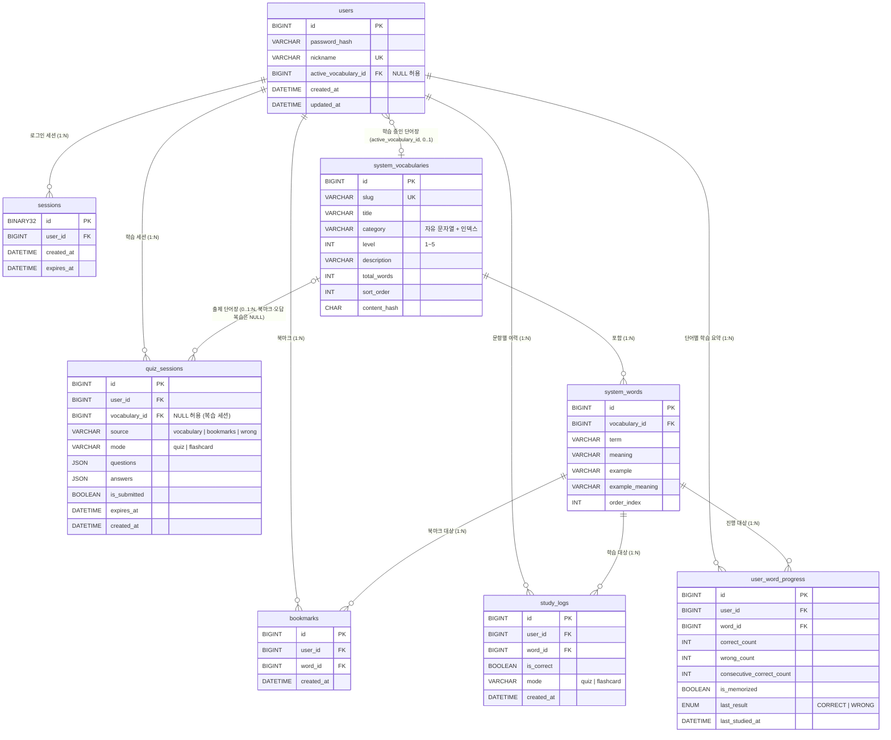

# 데이터 설계서 (Data Design)

| 항목 | 내용 |
| :--- | :--- |
| 프로젝트 | voda-voca (보다보카) |
| 문서 종류 | Data Design (`개발방법론.md` §2.3, 필수 산출물) |
| 기준 문서 | `docs/voda-voca_Requirement_Spec_v2.1_261105.md` (REQ-003, 012, 014~019, 102~109, 122, 129, 131~133, 140~143) |
| 버전 / 상태 | v2.1 / **승인 (Approved)** — 중앙 제공형 단어장 전환 반영 |
| 작성일 | 2026-11-05 (v2.0: 2026-11-02) |
| DBMS | MySQL 8.0 (Docker 컨테이너, `docker/docker-compose.yml`) |
| 엔진 / 문자셋 | InnoDB / `utf8mb4` / `utf8mb4_0900_ai_ci` |
| 산출물 경로 | `docs/voda-voca_Data_Design_v2.1_261105.md` (이전 버전: `docs/old/voda-voca_Data_Design_v2.0_261102.md` 외 보관) |
| 관련 결정 | `ai-agent/claude/검토_261102_ADR_핵심아키텍처결정.md` (ADR-001 세션, ADR-002 bcrypt), `ai-agent/claude/작업계획_261105_통합_설계안.md` |

> **v2.1 요약**: 개인 단어장 모델(`wordbooks`, `words`)을 폐지하고 서버가 제공하는 읽기 전용 카탈로그(`system_vocabularies`, `system_words`)와 사용자별 학습 요약(`user_word_progress`)으로 전환했다. 폐기된 테이블은 마이그레이션 `d1a8e3f5c7b9`(D-2)에서 DROP 되었다. 이 문서의 스키마는 실제 DB(`SHOW CREATE TABLE`)와 `alembic check` 로 대조했다.

---

## 1. ERD



> 삭제된 테이블: `wordbooks`, `words` (v2.0 까지 존재). ERD 에서 제거했다.

### 1.1 관계 요약과 삭제 정책

| 관계 | 카디널리티 | 설명 | 삭제 정책 |
| :--- | :---: | :--- | :--- |
| system_vocabularies → system_words | 1:N | 표준 단어장은 여러 단어를 가진다. | CASCADE (`fk_sysword_vocabulary`) |
| users → system_vocabularies (활성) | N:0..1 | `users.active_vocabulary_id`. 학습 중인 단어장 | **SET NULL** (`fk_users_active_vocabulary`) |
| users ↔ system_words (bookmarks) | M:N | `bookmarks` 가 교차 테이블 | CASCADE (양쪽) |
| users ↔ system_words (study_logs) | M:N | 문항 답안 1건당 1행 누적 | CASCADE (양쪽) |
| users ↔ system_words (user_word_progress) | M:N | 사용자×단어 1행의 학습 요약 | CASCADE (양쪽) |
| users → sessions | 1:N | 로그인 세션 | CASCADE |
| users → quiz_sessions | 1:N | 학습 세션 | CASCADE (`fk_quiz_sessions_user`) |
| system_vocabularies → quiz_sessions | 1:N (선택) | 활성 단어장 세션의 원천. 복습 세션은 NULL | CASCADE (`fk_quiz_sessions_vocabulary`) |

---

## 2. 공통 규칙

### 2.1 문자셋 및 콜레이션 (REQ-108)
- 모든 테이블: `ENGINE=InnoDB DEFAULT CHARSET=utf8mb4 COLLATE=utf8mb4_0900_ai_ci`
- 컬럼 단위 문자셋 지정은 하지 않는다 (테이블 기본값 상속).
- **대소문자·악센트 정책**: `utf8mb4_0900_ai_ci`는 대소문자를 구분하지 않고, 악센트도 구분하지 않는다 (`ai`). 따라서 `system_words(vocabulary_id, term)` UNIQUE는 `Apple`과 `apple`을 같은 표제어로 보며, `café`와 `cafe`도 같은 표제어로 본다. 이는 의도된 동작이다 (D2 확정).
- 이모지와 한글 저장을 위해 `utf8mb4`를 강제하며, `utf8` (utf8mb3)은 사용하지 않는다.
- **서버 기본값 정합**: 현재 `docker/docker-compose.yml`의 `--collation-server=utf8mb4_unicode_ci`는 본 설계와 다르다. 테이블은 명시적으로 `COLLATE=utf8mb4_0900_ai_ci`를 지정하므로 DDL 결과는 일치하지만, 서버 기본값도 맞추려면 컨테이너 재생성이 필요하다 (§6 F1).

### 2.2 시간대 정책 (REQ-108, REQ-109)
| 구분 | 정책 |
| :--- | :--- |
| 저장 값 | 모든 `DATETIME(3)` 컬럼은 **UTC**로 저장한다. |
| 기본값 | `DEFAULT (UTC_TIMESTAMP(3))` 을 사용한다. `NOW()`나 `CURRENT_TIMESTAMP`는 세션 시간대(+09:00)의 영향을 받으므로 쓰지 않는다. |
| 세션 시간대 | 컨테이너 설정 `--default-time-zone=+09:00`을 유지한다. 세션 값은 `NOW()` 같은 함수 결과에만 영향을 주며, 설계상 저장 기준으로 쓰지 않는다. |
| 표시 | 응답 직렬화 시 UTC를 Asia/Seoul(KST)로 변환한다. 변환은 프론트엔드 표시 단계에서 수행한다 (REQ-109 확정). |
| 타입 선택 | `TIMESTAMP`(자동 UTC 변환, 2038년 문제)를 쓰지 않고 `DATETIME(3)`을 쓴다. 밀리초 정밀도를 유지한다. |

> **근거**: `TIMESTAMP`는 세션 시간대에 따라 입출력 값이 달라지므로, 시간대 설정이 바뀌면 같은 행의 값이 다르게 보이는 문제가 생긴다. UTC 값을 `DATETIME`에 명시적으로 저장하면 설정 변경과 무관하게 값이 고정된다.

### 2.3 기본 키 및 공통 컬럼
- PK: `id BIGINT UNSIGNED AUTO_INCREMENT`. 행 수 증가에 대비해 INT가 아닌 BIGINT를 쓴다.
- 생성/수정 시각: `created_at`, `updated_at` (`DATETIME(3)`, UTC). 생성 시각은 `DEFAULT (UTC_TIMESTAMP(3))`로 채운다.
- 수정 시각 `updated_at`은 DB의 `ON UPDATE`절로 갱신하지 않는다. MySQL의 `ON UPDATE`는 `CURRENT_TIMESTAMP` 계열만 허용하며 `UTC_TIMESTAMP`는 쓸 수 없다. 대신 애플리케이션 계층(SQLAlchemy `onupdate`)에서 UTC 시각을 명시적으로 설정한다.
- 소프트 삭제 컬럼(`deleted_at`)은 두지 않는다. 삭제 정책은 하드 삭제다.

### 2.4 삭제 연쇄 (REQ-104, REQ-122)
- 사용자 소유 행(`sessions`, `bookmarks`, `study_logs`, `user_word_progress`, `quiz_sessions`)의 FK 는 `ON DELETE CASCADE` 다. **회원 탈퇴(REQ-122)는 `users` 행 하나를 지우면 이들이 DB 수준에서 함께 정리된다.**
- **표준 단어장·단어는 공용 콘텐츠이므로 탈퇴로 지워지지 않는다.** `system_*` 테이블은 `users` 를 참조하지 않는다.
- 표준 단어(`system_words`)가 삭제되면(시드 정리 같은 운영 작업) 그 단어의 북마크, 학습 이력, 학습 요약이 함께 삭제된다. 표준 단어장(`system_vocabularies`)이 삭제되면 단어, 그 단어장 출처 세션이 삭제되고 `users.active_vocabulary_id` 는 `NULL` 이 된다.
- **단어 삭제는 학습 세션을 삭제하지 않는다.** 문항 정보가 `questions` JSON 에 들어 있어 `quiz_sessions` 와 `system_words` 사이에 FK 가 없다. 대신 답을 기록할 때 서비스 계층이 단어 존재를 확인하고, 없으면 409(`QUIZ_WORD_MISSING`)로 막는다 (§3.7).
- 학습 이력은 삭제 후에도 보존하지 않는다 (하드 삭제 정책).

### 2.5 검색 정책
- v2.1 에서 표제어 검색 API 는 제공하지 않는다 (REQ-009 폐기). 단어 목록은 `(vocabulary_id, order_index)` 순서의 페이지 조회다 (§3.3).

---

## 3. 테이블 명세

### 3.1 users (계정) — REQ-001, REQ-002, REQ-003, REQ-110

| 컬럼 | 타입 | NULL | 기본값 | 제약 / 설명 |
| :--- | :--- | :---: | :--- | :--- |
| `id` | BIGINT UNSIGNED | N | AUTO_INCREMENT | **PK** |
| `password_hash` | VARCHAR(255) | N | — | bcrypt 해시 (REQ-110, ADR-002). 평문 저장 금지. 60자 고정 길이이며 여유를 두어 255로 정의한다. |
| `nickname` | VARCHAR(50) | N | — | **UNIQUE** (`uk_users_nickname`). 로그인 식별자이자 표시 이름. 앱 검증은 2~30자(공백 제거 후), DB 콜레이션 `utf8mb4_0900_ai_ci` 기준으로 대소문자를 무시하고 유일하다 (v1.3). |
| `created_at` | DATETIME(3) | N | `(UTC_TIMESTAMP(3))` | UTC |
| `updated_at` | DATETIME(3) | N | `(UTC_TIMESTAMP(3))` | UTC, 수정 시 앱에서 갱신 |
| `active_vocabulary_id` | BIGINT UNSIGNED | Y | NULL | **FK** → `system_vocabularies.id` `ON DELETE SET NULL` (`fk_users_active_vocabulary`). 학습 중인 표준 단어장 (REQ-142). 가입 시 `beginner-200`(초급 200제)이 자동 지정된다. 마이그레이션 `b1e5c0a7d2f4`. |

**인덱스**: `PRIMARY KEY (id)`, `UNIQUE KEY uk_users_nickname (nickname)`, `KEY fk_users_active_vocabulary (active_vocabulary_id)` (FK 자동 생성)

> v1.3 변경: `email` 컬럼과 `uk_users_email` 을 제거하고 `nickname` 을 고유 키로 승격했다 (마이그레이션 `3384caa6f116`). 중복 닉네임이 있으면 마이그레이션은 중단하며 데이터를 임의로 바꾸지 않는다. 내리기 시 제거된 이메일 값은 복구되지 않는다.

**CHECK**: `ck_users_nickname_not_blank` — `CHAR_LENGTH(TRIM(nickname)) > 0`

> 로그인 세션은 `sessions` 테이블(§3.6)에 저장한다 (ADR-001).

---

### 3.2 system_vocabularies (표준 단어장) — REQ-140, REQ-143

서버 시드 파일로만 바뀌는 읽기 전용 카탈로그다. 사용자 쓰기 경로는 없다.

| 컬럼 | 타입 | NULL | 기본값 | 제약 / 설명 |
| :--- | :--- | :---: | :--- | :--- |
| `id` | BIGINT UNSIGNED | N | AUTO_INCREMENT | **PK** |
| `slug` | VARCHAR(50) | N | — | **UNIQUE** (`uk_sysvoc_slug`). 시드 멱등 키 (예: `beginner-200`). |
| `title` | VARCHAR(100) | N | — | 표시 이름. 공백만으로 둘 수 없다. |
| `category` | VARCHAR(50) | N | — | **자유 문자열 + 인덱스** (`idx_sysvoc_category`). ENUM/CHECK 를 쓰지 않는다 — 새 카테고리(CONVERSATION, TOEIC 등)를 스키마 변경 없이 시드만으로 추가한다. 현재 `ELEMENTARY`, `SECONDARY`, `CSAT`. 탐색 필터 칩의 근거다. |
| `level` | INT | N | `1` | 난이도 1~5 (`ck_sysvoc_level_range`). |
| `description` | VARCHAR(255) | Y | NULL | 설명 |
| `total_words` | INT UNSIGNED | N | `0` | 시더가 실제 단어 수로 갱신하는 비정규화 값 |
| `sort_order` | INT | N | `0` | 카탈로그 노출 순서 |
| `content_hash` | VARCHAR(64) | Y | NULL | 시드 내용의 SHA-256. 같으면 쓰기를 건너뛴다. NULL 이면 아직 적재되지 않은 행이다. |
| `created_at`, `updated_at` | DATETIME(3) | N | `(UTC_TIMESTAMP(3))` | UTC |

**인덱스**: `PRIMARY KEY (id)`, `UNIQUE uk_sysvoc_slug (slug)`, `KEY idx_sysvoc_category (category)`
**CHECK**: `ck_sysvoc_level_range` (`level BETWEEN 1 AND 5`), `ck_sysvoc_title_not_blank` (`CHAR_LENGTH(TRIM(title)) > 0`)

### 3.3 system_words (표준 단어) — REQ-141, REQ-143

| 컬럼 | 타입 | NULL | 기본값 | 제약 / 설명 |
| :--- | :--- | :---: | :--- | :--- |
| `id` | BIGINT UNSIGNED | N | AUTO_INCREMENT | **PK** |
| `vocabulary_id` | BIGINT UNSIGNED | N | — | **FK** → `system_vocabularies.id` `ON DELETE CASCADE` (`fk_sysword_vocabulary`) |
| `term` | VARCHAR(100) | N | — | 표제어 |
| `meaning` | VARCHAR(200) | N | — | 뜻 |
| `example` | VARCHAR(500) | Y | NULL | 예문 |
| `example_meaning` | VARCHAR(500) | Y | NULL | 예문의 한글 뜻. **예문이 없으면 항상 NULL** (D14). |
| `pos` | VARCHAR(20) | Y | NULL | 품사 (v2.2 사용, REQ-145). **영문 소문자 단어** (`noun`, `verb`, `adjective`, `adverb`, `preposition`, `conjunction`, `pronoun`, `interjection`). 시드 1,000단어 전부 채운다 (신규 2개 단어장은 v2.2, 기존 3개 단어장 600단어는 v2.2 후속). 컬럼은 NULL 허용으로 남긴다. **API 로 내려가고 화면이 한글 라벨을 입힌다** (REQ-146). 시드 로더는 문자열·20자 이하만 검증하고, 허용 집합은 시드 관문 테스트가 강제한다. 마이그레이션은 없다 (`b1e5c0a7d2f4` 가 이미 만든 컬럼) |
| `phonetic` | VARCHAR(100) | Y | NULL | 발음기호 (v2.2 사용, REQ-144). **슬래시 없는 미국식 IPA 문자열** (예: `ˈæpəl`). 화면이 `/…/` 서식을 입힌다. NULL 이면 화면이 발음기호 요소를 그리지 않는다. 시드 로더가 IPA 문자만 허용하고 한글·슬래시·대괄호·제어 문자·100자 초과를 거부한다. 값이 없는 단어는 NULL 이며 빈 문자열로 저장하지 않는다. 마이그레이션은 없다 (`b1e5c0a7d2f4` 가 이미 같은 규격으로 만들었다) |
| `level` | TINYINT | Y | NULL | 단어 난이도. **확장 필드, 1단계 미사용** |
| `order_index` | INT | N | `0` | 단어장 안의 순서. 미학습 단어는 이 순서로 출제된다 (REQ-012). |

**인덱스**: `PRIMARY KEY (id)`, `UNIQUE uk_sysword_vocab_term (vocabulary_id, term)` (콜레이션 `ai_ci` 라 대소문자·악센트를 무시하고 유일), `KEY idx_sysword_vocab_order (vocabulary_id, order_index)`
**CHECK**: `ck_sysword_not_blank` (`CHAR_LENGTH(TRIM(term)) > 0 AND CHAR_LENGTH(TRIM(meaning)) > 0`)

**설계 메모**
- 단어 목록(`GET /api/vocabularies/{id}/words`)은 `WHERE vocabulary_id = ? ORDER BY order_index` 의 OFFSET 페이징이다. 단어장당 수백~천 건이라 keyset 은 도입하지 않는다.
- `words` 와 달리 `user_id` 가 없다 — 공용 콘텐츠이므로 소유권 개념이 없다.

### 3.4 user_word_progress (사용자별 단어 학습 요약) — REQ-016, REQ-012

사용자×단어 1행. `study_logs` 를 매번 훑지 않고 세션 출제와 숙련 판정을 빠르게 하기 위한 요약이다. 간격 반복(`next_review_at` 등)은 아직 만들지 않으며, 이 테이블이 확장 지점이다.

| 컬럼 | 타입 | NULL | 기본값 | 제약 / 설명 |
| :--- | :--- | :---: | :--- | :--- |
| `id` | BIGINT UNSIGNED | N | AUTO_INCREMENT | **PK** |
| `user_id` | BIGINT UNSIGNED | N | — | **FK** → `users.id` `ON DELETE CASCADE` (`fk_uwp_user`) |
| `word_id` | BIGINT UNSIGNED | N | — | **FK** → `system_words.id` `ON DELETE CASCADE` (`fk_uwp_word`) |
| `correct_count` | INT UNSIGNED | N | `0` | 누적 정답 수 |
| `wrong_count` | INT UNSIGNED | N | `0` | 누적 오답 수 |
| `consecutive_correct_count` | INT UNSIGNED | N | `0` | 연속 정답 수. 오답이면 0 |
| `is_memorized` | BOOLEAN | N | `0` | 숙련 여부 |
| `last_result` | ENUM('CORRECT','WRONG') | Y | NULL | 마지막 결과 |
| `last_studied_at` | DATETIME(3) | Y | NULL | 마지막 학습 시각 (UTC) |

**인덱스**: `PRIMARY KEY (id)`, `UNIQUE uk_uwp_user_word (user_id, word_id)`, `KEY idx_uwp_user_result (user_id, last_result)`, `KEY idx_uwp_user_memorized (user_id, is_memorized)`, `KEY idx_uwp_word (word_id)`

**숙련 규칙 (`services/progress.py` 의 `apply_result`, 불변 상태 전이)**

| 결과 | 변경 |
| :--- | :--- |
| 정답 | `correct_count += 1`, `consecutive_correct_count += 1`, `last_result = 'CORRECT'`, 연속이 **3 이상**이면 `is_memorized = TRUE` |
| 오답 | `wrong_count += 1`, `consecutive_correct_count = 0`, `is_memorized = FALSE`, `last_result = 'WRONG'` |

**설계 메모**
- 갱신은 `services/study_log.py` 의 `record_result` 가 **`study_logs` INSERT 와 같은 트랜잭션**에서 한다. 행이 없으면 `INSERT ... ON DUPLICATE KEY UPDATE` 로 먼저 만들고, `SELECT ... FOR UPDATE` 로 잠근 채 갱신하므로 동시 기록도 정확히 센다.
- 이 테이블의 행 유무가 "학습한 단어"의 기준이다. 단어장 진행률(`studied_words`)은 이 테이블에서 센다.

### 3.5 bookmarks (북마크) — REQ-017, REQ-018, REQ-105

| 컬럼 | 타입 | NULL | 기본값 | 제약 / 설명 |
| :--- | :--- | :---: | :--- | :--- |
| `id` | BIGINT UNSIGNED | N | AUTO_INCREMENT | **PK** |
| `user_id` | BIGINT UNSIGNED | N | — | **FK** → `users.id` `ON DELETE CASCADE` |
| `word_id` | BIGINT UNSIGNED | N | — | **FK** → `system_words.id` `ON DELETE CASCADE` (v2.0 까지 `words.id`, 마이그레이션 `c3f7a9d1e8b2` 에서 전환) |
| `created_at` | DATETIME(3) | N | `(UTC_TIMESTAMP(3))` | UTC |

**인덱스**: `PRIMARY KEY (id)`, `UNIQUE uk_bookmarks_user_word (user_id, word_id)`, `KEY idx_bookmarks_word (word_id)`

**설계 메모**
- 대상이 공용 단어이므로 v2.0 의 "단어장 소유자 검증"(D3)은 필요 없다. 없는 `word_id` 는 404 다.
- 북마크 목록은 `bookmarks → system_words → system_vocabularies` 조인으로 단어장 제목을 함께 돌려준다.

### 3.6 study_logs (학습 이력) — REQ-016

문항 답안 1건당 1행. 단어별 누적 요약은 `user_word_progress`(§3.4)가 맡고, 이 테이블은 시간순 원본 기록이다.

| 컬럼 | 타입 | NULL | 기본값 | 제약 / 설명 |
| :--- | :--- | :---: | :--- | :--- |
| `id` | BIGINT UNSIGNED | N | AUTO_INCREMENT | **PK** |
| `user_id` | BIGINT UNSIGNED | N | — | **FK** → `users.id` `ON DELETE CASCADE` |
| `word_id` | BIGINT UNSIGNED | N | — | **FK** → `system_words.id` `ON DELETE CASCADE` (`fk_study_logs_word`) |
| `is_correct` | BOOLEAN | N | — | 정답 1, 오답 0. 플래시카드의 "알아요" = 정답, "헷갈려요" = 오답 |
| `created_at` | DATETIME(3) | N | `(UTC_TIMESTAMP(3))` | UTC. 답을 기록한 시각 |
| `mode` | VARCHAR(20) | N | `'quiz'` | `'quiz'` \| `'flashcard'` (`ck_study_logs_mode`). 마이그레이션 `c3f7a9d1e8b2` 에서 추가 |

**인덱스**: `PRIMARY KEY (id)`, `KEY idx_study_logs_user_created (user_id, created_at)`, `KEY idx_study_logs_word (word_id)`

**설계 메모**
- **기록 방식 (v2.1 변경)**: 세션에서 **답 1건마다** INSERT 한다. 이력 1행과 `user_word_progress` 갱신이 한 트랜잭션이다 (REQ-016, REQ-106). v2.0 의 "제출 시 일괄 INSERT"는 폐기되었다.
- **최근 이력 쿼리**: `WHERE user_id = ? ORDER BY created_at DESC, id DESC LIMIT 100` (`GET /api/study/logs`).
- **오답 판정**: 단어별 `(created_at DESC, id DESC)` 최신 1건이 오답인 단어 (`services/stats.py` 의 `wrong_word_ids`, 윈도 함수 `ROW_NUMBER`). 기간 제한이 없으며 통계의 `wrong_word_count`, 오답 복습 세션, `GET /api/study/wrong-words` 가 같은 규칙을 쓴다.
- **통계 집계**: 누적 정답률, 연속 학습일(KST 날짜 경계), 최근 7일, 단어장별 진행률은 서버가 이 테이블과 `user_word_progress` 에서 직접 센다 (REQ-131). 별도 집계 테이블은 없다.
- **단어 삭제와의 상호작용**: 기록 직전에 단어 존재를 확인하고, 확인 뒤 경쟁으로 FK(`fk_study_logs_word`, `fk_uwp_word`)가 깨지면 롤백하고 409 로 바꾼다.
- **보존 기간**: 삭제 정책을 두지 않는다.

### 3.7 quiz_sessions (학습 세션) — REQ-012, REQ-014~016, REQ-106

학습 세션 1회분의 서버 측 상태다. 테이블 이름은 호환을 위해 `quiz_sessions` 를 유지하지만 퀴즈와 플래시카드 세션을 모두 담는다 (`mode`).

| 컬럼 | 타입 | NULL | 기본값 | 제약 / 설명 |
| :--- | :--- | :---: | :--- | :--- |
| `id` | BIGINT UNSIGNED | N | AUTO_INCREMENT | **PK** |
| `user_id` | BIGINT UNSIGNED | N | — | **FK** → `users.id` `ON DELETE CASCADE` |
| `vocabulary_id` | BIGINT UNSIGNED | Y | NULL | **FK** → `system_vocabularies.id` `ON DELETE CASCADE` (`fk_quiz_sessions_vocabulary`). `source='vocabulary'` 일 때 원천 단어장. 북마크·오답 복습이면 NULL. v2.0 의 `wordbook_id` 를 대체 |
| `source` | VARCHAR(16) | N | — | `'vocabulary'` \| `'bookmarks'` \| `'wrong'` (`ck_quiz_sessions_source`). API 의 `source=all` 은 `'vocabulary'` 로 저장된다 |
| `mode` | VARCHAR(20) | N | `'quiz'` | `'quiz'` \| `'flashcard'` (`ck_quiz_sessions_mode`) |
| `questions` | JSON | N | — | 문항 배열. 아래 구조 |
| `answers` | JSON | N | `(JSON_OBJECT())` | 기록된 답 `{"문항번호": 값}`. 퀴즈는 선택한 보기 번호(0~3), 플래시카드는 알아요=1 / 헷갈려요=0 |
| `is_submitted` | BOOLEAN | N | — | 모든 문항에 답해 세션이 끝나면 `TRUE` |
| `expires_at` | DATETIME(3) | N | — | UTC. 출제 시각 + 30분이며 **답을 기록할 때마다 30분씩 밀린다**(밀리초 정밀도로 맞춤). 이 시각 이후 새 답은 거부된다 (이미 푼 답은 저장되어 있다) |
| `created_at` | DATETIME(3) | N | `(UTC_TIMESTAMP(3))` | UTC. 출제 시각 |

**`questions` JSON 구조** (문항 1건, 서버 보관용 — 출제 응답에는 일부만 싣는다)

```json
{
  "question_id": 0,
  "word_id": 123,
  "term": "apple",
  "choices": ["사과", "배", "포도", "바나나"],
  "correct_index": 0,
  "example": "I eat an apple.",
  "example_meaning": "나는 매일 아침 사과를 먹는다.",
  "phonetic": "ˈæpəl",
  "pos": "noun"
}
```

- 플래시카드 문항은 `choices` 가 `[]`, `correct_index` 가 `null` 이다.
- **노출 규칙 (v2.1)**: 출제 응답(`POST /api/study/sessions`)은 `question_id`, `word_id`, `term`, `context`(예문)와 퀴즈의 `options` 만 싣는다. `correct_index`, `meaning`, `example_meaning` 은 싣지 않고, **채점 응답**(`POST .../answer`)에서만 공개한다. (플래시카드는 정답이 없으므로 뒷면 뜻을 출제 응답에 함께 싣는다.) v2.0 D11 의 "출제 응답에 정답 포함"은 폐기되었다 (D16).
- `phonetic` (v2.2) 은 **시작 시점의 `system_words.phonetic` 스냅샷**이다. 읽을 때는 `question.get("phonetic")` 로 다뤄, v2.2 이전에 만든 진행 중 세션(키 없음)은 null 로 응답한다. 퀴즈 출제 응답에는 이 값을 싣지 않고(항상 null), 채점 응답과 플래시카드 출제 응답에서만 내려간다 (REQ-144).
- `pos` (v2.2, REQ-146) 도 **시작 시점의 `system_words.pos` 스냅샷**이다. `question.get("pos")` 로 읽어 옛 세션(키 없음)은 null 로 응답한다. 발음기호와 달리 **퀴즈 출제 응답에도 싣는다**.
- `question_id` 는 0부터 시작하는 배열 위치 번호다.

**인덱스**: `PRIMARY KEY (id)`, `KEY idx_quiz_sessions_user (user_id)`, `KEY fk_quiz_sessions_vocabulary (vocabulary_id)` (FK 자동 생성)

**설계 메모**
- **멱등 기록**: 답 기록은 `quiz_sessions` 행을 `SELECT ... FOR UPDATE` 로 잠근 뒤 처리한다. 같은 문항에 같은 답을 다시 보내면 이력을 늘리지 않고 같은 응답을 돌려주며, 다른 답이면 409(`QUIZ_ANSWER_LOCKED`)다.
- **출제 규칙** (`services/session_picker.py` 순수 함수 + `services/learning_session.py`): `source=all` 은 워터폴 — 오답 풀 최대 `floor(0.3×N)`, 기학습 복습 `floor(0.1×N)` 선확보, 나머지 미학습(`order_index` 순), 모자라면 복습으로 충원, 숙련 단어는 `include_memorized=false` 일 때 제외, 출제 후 섞는다. `bookmarks`/`wrong` 은 해당 풀에서 무작위로 고른다.
- **보기 생성**: 오답 3개는 같은 단어장의 다른 단어 뜻을 우선하고 부족하면 전체 표준 단어에서 보충하며 뜻이 같은 보기는 쓰지 않는다. 활성 단어장이 4개 미만이면 퀴즈는 출제하지 않는다 (플래시카드는 허용).
- **만료 정리**: 만료·미완료 행의 물리 삭제는 하지 않는다.

---

### 3.8 sessions (로그인 세션) — REQ-001, REQ-002

세션 쿠키 인증(REQ-001 확정)의 서버 측 저장소다 (ADR-001). 클라이언트 쿠키에는 무작위 토큰 원문을 두고, DB에는 그 토큰의 SHA-256 다이제스트만 저장한다. DB가 노출되어도 유효한 세션 토큰이 노출되지 않도록 하기 위함이다.

| 컬럼 | 타입 | NULL | 기본값 | 제약 / 설명 |
| :--- | :--- | :---: | :--- | :--- |
| `id` | BINARY(32) | N | — | **PK**. 세션 토큰의 SHA-256 다이제스트(원문 32바이트). 쿠키 원문은 저장하지 않는다. |
| `user_id` | BIGINT UNSIGNED | N | — | **FK** → `users.id` `ON DELETE CASCADE` |
| `created_at` | DATETIME(3) | N | `(UTC_TIMESTAMP(3))` | UTC. 로그인 시각. |
| `expires_at` | DATETIME(3) | N | — | UTC. 만료 시각. 기본 수명은 로그인 후 14일이다 (절대 만료, 슬라이딩 연장 없음). |

**인덱스**
- `PRIMARY KEY (id)`
- `KEY idx_sessions_user (user_id)`: 사용자별 세션 일괄 삭제(계정 삭제·전체 로그아웃)용.
- `KEY idx_sessions_expires (expires_at)`: 만료 세션 정리 작업용.

**설계 메모**
- **ORM 매핑**: 테이블 이름은 `sessions`이고, ORM 클래스는 `AuthSession`이다. SQLAlchemy의 `Session`과 이름이 겹치는 것을 피하기 위함이다 (`src/backend/models/session.py`). 설계서와 DDL에서는 테이블 이름 `sessions`를 쓰고, 코드에서는 `AuthSession`을 쓴다.
- 인증 시 `WHERE id = ? AND expires_at > UTC_TIMESTAMP(3)`으로 조회한다. 만료 세션은 조회되지 않는다.
- 로그아웃은 해당 행을 삭제한다 (REQ-002). 삭제 후에는 같은 쿠키로 접근할 수 없다.
- 만료된 행의 물리 삭제 작업은 1차에서 필요하지 않으나, 행이 누적되면 `idx_sessions_expires`로 배치 삭제한다.
- 쿠키 속성(`HttpOnly`, `SameSite=Lax`, `Secure`)은 `.env`에서 주입한다 (REQ-112). `Secure`는 HTTPS 환경에서만 켠다.

---

### 3.9 시드 데이터 (애플리케이션 데이터) — REQ-143

표준 단어장의 원본은 저장소의 JSON 파일이다 (DB 템플릿 테이블 없음, 사용자별 복제 없음).

| 파일 (`src/backend/data/seeds/`) | 내용 |
| :--- | :--- |
| `vocabularies.json` | 단어장 메타 배열: `slug`, `title`, `category`, `level`, `description`, `sort_order` |
| `words/beginner-200.json` | `beginner-200` (초급 필수 영단어 200, `ELEMENTARY`, level 1) |
| `words/intermediate-200.json` | `intermediate-200` (중급 핵심 영단어 200, `SECONDARY`, level 2) |
| `words/advanced-200.json` | `advanced-200` (고급 심화 영단어 200, `CSAT`, level 3) |
| `words/exam-core-200.json` | `exam-core-200` (시험 대비 핵심 200, `EXAM`, level 3, `sort_order` 4) — v2.2 |
| `words/business-practical-200.json` | `business-practical-200` (실무 비즈니스 영단어 200, `BUSINESS`, level 3, `sort_order` 5) — v2.2 |

- 단어 항목은 `{"term", "meaning", "example", "example_meaning"}` 에 선택 키 `"phonetic"`(v2.2, 슬래시 없는 IPA)과 `"pos"`(v2.2, 영문 소문자 품사)를 더한 것이다. 신규 2개 단어장은 6개 키가 모두 필수(관문 테스트)이고, 기존 3개는 `pos` 가 없다. `phonetic` 키가 없으면 NULL 로 해석한다. 총 **1,000단어**(기존 600 + 신규 400)이며 v2.2 시드는 1,000개 전부 `phonetic` 을 가진다. IPA 는 CMU Pronouncing Dictionary(BSD 계열)에서 변환했다 (출처 고지: 요구사항 명세 §10).
- `services/system_seed.py` 가 앱 시작 시(`lifespan` 의 `init_system_seeds`) 시드를 검증하고 적재한다. **검증에 실패하면 DB 에 아무것도 쓰지 않는다** (`SeedValidationError`).
- **멱등성**: `slug` 가 키다. 파일 내용의 SHA-256 을 `content_hash` 와 비교해 같으면 쓰기를 건너뛴다. 달라지면 단어를 갱신하고 `total_words` 를 실제 개수로 맞춘다. **`content_hash` 입력과 갱신 비교 항목에 `phonetic` 이 포함된다** (v2.2). `pos` 는 **값이 있을 때만** 단어 항목 끝에 덧붙여 해시에 넣고(갱신 비교에는 항상 포함), 그래서 `pos` 가 없는 기존 3개 단어장의 해시는 이전과 바이트 단위로 같다 (골든 해시 테스트로 고정). 키가 없는 것과 명시적 null 은 같은 내용이다. 신규 단어장은 앱 시작 시 한 번 `created` 로 적재되고, 기존 단어장의 `word_id`·`updated_at` 은 바뀌지 않는다. 값이 바뀌면 UPDATE, 시드에서 지우면 NULL 로 되돌린다. 해시 입력이 바뀐 첫 시작에는 세 단어장이 한 번 재적재된다 (실제 변경은 `phonetic` 뿐).
- 새 카테고리·단어장은 파일 추가만으로 늘린다 (스키마 변경 없음).
- 가입 시 `services/auth.py` 의 `signup()` 이 `users` 행을 만들면서 `beginner-200` 을 `active_vocabulary_id` 로 지정한다 (단어 복사 없음).
- **삭제된 자료**: `beginner_200.json` 등 구 시드와 `intermediate_1000.csv` 프리셋은 제거되었다 (REQ-123, REQ-130 폐기).

---

## 4. 요구사항 매핑

| 요구사항 | 반영 테이블 / 컬럼 / 제약 |
| :--- | :--- |
| REQ-001 | `users.nickname` UNIQUE, `users.password_hash` (bcrypt), `users.active_vocabulary_id` 초기값 |
| REQ-002 | `sessions` 전체 |
| REQ-003 | 사용자 소유 행의 `user_id` 조건 (`bookmarks`, `study_logs`, `user_word_progress`, `quiz_sessions`). `system_*` 는 공용 |
| REQ-012 | `quiz_sessions` (`mode`, `source`, `questions`, `answers`), `user_word_progress` (출제 풀 분류), `system_words.order_index` |
| REQ-014, 015 | `quiz_sessions.questions` / `answers`, 보기 생성 규칙 (§3.7) |
| REQ-016 | `study_logs` 전체(`mode` 포함), `user_word_progress` 전체, 같은 트랜잭션 갱신 |
| REQ-017, 018 | `bookmarks` 전체, `uk_bookmarks_user_word` |
| REQ-019 | `quiz_sessions.source = 'bookmarks'` |
| REQ-104 | 모든 FK 의 CASCADE / SET NULL (§1.1, §2.4) |
| REQ-105 | `uk_users_nickname`, `uk_sysvoc_slug`, `uk_sysword_vocab_term`, `uk_bookmarks_user_word`, `uk_uwp_user_word` |
| REQ-106 | 답 1건의 이력 + 진행도 + 세션 갱신을 단일 트랜잭션, 세션 행 잠금 |
| REQ-107 | 모든 DDL 은 Alembic. `alembic check` 불일치 0건 |
| REQ-108, 109 | §2.1, §2.2 |
| REQ-110 | `users.password_hash` |
| REQ-122 | `users` 삭제 시 `sessions`, `bookmarks`, `study_logs`, `user_word_progress`, `quiz_sessions` CASCADE. `system_*` 보존 |
| REQ-129 | `study_logs` 의 단어별 마지막 결과(윈도 함수) → `quiz_sessions.source = 'wrong'` |
| REQ-131~133 | `study_logs`, `user_word_progress`, `system_vocabularies.total_words` 서버 집계 |
| REQ-140 | `system_vocabularies` (`category` 인덱스), `user_word_progress` 집계 |
| REQ-141 | `system_words` (`idx_sysword_vocab_order`), `bookmarks` 조인 |
| REQ-142 | `users.active_vocabulary_id` (`ON DELETE SET NULL`) |
| REQ-143 | `system_vocabularies.slug`, `content_hash`, 시드 파일 (§3.9) |
| REQ-145 | `system_vocabularies` 2행 추가(`category` `EXAM`·`BUSINESS`), `system_words.pos`, 시드 파일 2개 (§3.3, §3.9) |

---

## 5. DDL (현행 스키마, `SHOW CREATE TABLE` 기준)

```sql
CREATE TABLE users (
  id            BIGINT UNSIGNED NOT NULL AUTO_INCREMENT,
  password_hash VARCHAR(255)    NOT NULL,
  nickname      VARCHAR(50)     NOT NULL,
  created_at    DATETIME(3)     NOT NULL DEFAULT (UTC_TIMESTAMP(3)),
  updated_at    DATETIME(3)     NOT NULL DEFAULT (UTC_TIMESTAMP(3)),
  active_vocabulary_id BIGINT UNSIGNED NULL,
  PRIMARY KEY (id),
  UNIQUE KEY uk_users_nickname (nickname),
  KEY fk_users_active_vocabulary (active_vocabulary_id),
  CONSTRAINT fk_users_active_vocabulary FOREIGN KEY (active_vocabulary_id) REFERENCES system_vocabularies (id) ON DELETE SET NULL,
  CONSTRAINT ck_users_nickname_not_blank CHECK (CHAR_LENGTH(TRIM(nickname)) > 0)
) ENGINE=InnoDB DEFAULT CHARSET=utf8mb4 COLLATE=utf8mb4_0900_ai_ci;

CREATE TABLE system_vocabularies (
  id            BIGINT UNSIGNED NOT NULL AUTO_INCREMENT,
  slug          VARCHAR(50)     NOT NULL,
  title         VARCHAR(100)    NOT NULL,
  category      VARCHAR(50)     NOT NULL,
  level         INT             NOT NULL DEFAULT 1,
  description   VARCHAR(255)    NULL,
  total_words   INT UNSIGNED    NOT NULL DEFAULT 0,
  sort_order    INT             NOT NULL DEFAULT 0,
  content_hash  VARCHAR(64)     NULL,
  created_at    DATETIME(3)     NOT NULL DEFAULT (UTC_TIMESTAMP(3)),
  updated_at    DATETIME(3)     NOT NULL DEFAULT (UTC_TIMESTAMP(3)),
  PRIMARY KEY (id),
  UNIQUE KEY uk_sysvoc_slug (slug),
  KEY idx_sysvoc_category (category),
  CONSTRAINT ck_sysvoc_level_range CHECK (level BETWEEN 1 AND 5),
  CONSTRAINT ck_sysvoc_title_not_blank CHECK (CHAR_LENGTH(TRIM(title)) > 0)
) ENGINE=InnoDB DEFAULT CHARSET=utf8mb4 COLLATE=utf8mb4_0900_ai_ci;

CREATE TABLE system_words (
  id              BIGINT UNSIGNED NOT NULL AUTO_INCREMENT,
  vocabulary_id   BIGINT UNSIGNED NOT NULL,
  term            VARCHAR(100)    NOT NULL,
  meaning         VARCHAR(200)    NOT NULL,
  example         VARCHAR(500)    NULL,
  example_meaning VARCHAR(500)    NULL,
  pos             VARCHAR(20)     NULL,
  phonetic        VARCHAR(100)    NULL,
  level           TINYINT         NULL,
  order_index     INT             NOT NULL DEFAULT 0,
  PRIMARY KEY (id),
  UNIQUE KEY uk_sysword_vocab_term (vocabulary_id, term),
  KEY idx_sysword_vocab_order (vocabulary_id, order_index),
  CONSTRAINT fk_sysword_vocabulary FOREIGN KEY (vocabulary_id) REFERENCES system_vocabularies (id) ON DELETE CASCADE,
  CONSTRAINT ck_sysword_not_blank CHECK (CHAR_LENGTH(TRIM(term)) > 0 AND CHAR_LENGTH(TRIM(meaning)) > 0)
) ENGINE=InnoDB DEFAULT CHARSET=utf8mb4 COLLATE=utf8mb4_0900_ai_ci;

CREATE TABLE user_word_progress (
  id                        BIGINT UNSIGNED NOT NULL AUTO_INCREMENT,
  user_id                   BIGINT UNSIGNED NOT NULL,
  word_id                   BIGINT UNSIGNED NOT NULL,
  correct_count             INT UNSIGNED    NOT NULL DEFAULT 0,
  wrong_count               INT UNSIGNED    NOT NULL DEFAULT 0,
  consecutive_correct_count INT UNSIGNED    NOT NULL DEFAULT 0,
  is_memorized              BOOLEAN         NOT NULL DEFAULT 0,
  last_result               ENUM('CORRECT','WRONG') NULL,
  last_studied_at           DATETIME(3)     NULL,
  PRIMARY KEY (id),
  UNIQUE KEY uk_uwp_user_word (user_id, word_id),
  KEY idx_uwp_user_result (user_id, last_result),
  KEY idx_uwp_user_memorized (user_id, is_memorized),
  KEY idx_uwp_word (word_id),
  CONSTRAINT fk_uwp_user FOREIGN KEY (user_id) REFERENCES users (id) ON DELETE CASCADE,
  CONSTRAINT fk_uwp_word FOREIGN KEY (word_id) REFERENCES system_words (id) ON DELETE CASCADE
) ENGINE=InnoDB DEFAULT CHARSET=utf8mb4 COLLATE=utf8mb4_0900_ai_ci;

CREATE TABLE bookmarks (
  id         BIGINT UNSIGNED NOT NULL AUTO_INCREMENT,
  user_id    BIGINT UNSIGNED NOT NULL,
  word_id    BIGINT UNSIGNED NOT NULL,
  created_at DATETIME(3)     NOT NULL DEFAULT (UTC_TIMESTAMP(3)),
  PRIMARY KEY (id),
  UNIQUE KEY uk_bookmarks_user_word (user_id, word_id),
  KEY idx_bookmarks_word (word_id),
  CONSTRAINT fk_bookmarks_user FOREIGN KEY (user_id) REFERENCES users (id) ON DELETE CASCADE,
  CONSTRAINT fk_bookmarks_word FOREIGN KEY (word_id) REFERENCES system_words (id) ON DELETE CASCADE
) ENGINE=InnoDB DEFAULT CHARSET=utf8mb4 COLLATE=utf8mb4_0900_ai_ci;

CREATE TABLE study_logs (
  id          BIGINT UNSIGNED NOT NULL AUTO_INCREMENT,
  user_id     BIGINT UNSIGNED NOT NULL,
  word_id     BIGINT UNSIGNED NOT NULL,
  is_correct  BOOLEAN         NOT NULL,
  created_at  DATETIME(3)     NOT NULL DEFAULT (UTC_TIMESTAMP(3)),
  mode        VARCHAR(20)     NOT NULL DEFAULT 'quiz',
  PRIMARY KEY (id),
  KEY idx_study_logs_user_created (user_id, created_at),
  KEY idx_study_logs_word (word_id),
  CONSTRAINT fk_study_logs_user FOREIGN KEY (user_id) REFERENCES users (id) ON DELETE CASCADE,
  CONSTRAINT fk_study_logs_word FOREIGN KEY (word_id) REFERENCES system_words (id) ON DELETE CASCADE,
  CONSTRAINT ck_study_logs_mode CHECK (mode IN ('quiz', 'flashcard'))
) ENGINE=InnoDB DEFAULT CHARSET=utf8mb4 COLLATE=utf8mb4_0900_ai_ci;

CREATE TABLE sessions (
  id          BINARY(32)      NOT NULL,
  user_id     BIGINT UNSIGNED NOT NULL,
  created_at  DATETIME(3)     NOT NULL DEFAULT (UTC_TIMESTAMP(3)),
  expires_at  DATETIME(3)     NOT NULL,
  PRIMARY KEY (id),
  KEY idx_sessions_user (user_id),
  KEY idx_sessions_expires (expires_at),
  CONSTRAINT fk_sessions_user FOREIGN KEY (user_id) REFERENCES users (id) ON DELETE CASCADE
) ENGINE=InnoDB DEFAULT CHARSET=utf8mb4 COLLATE=utf8mb4_0900_ai_ci;

CREATE TABLE quiz_sessions (
  id            BIGINT UNSIGNED NOT NULL AUTO_INCREMENT,
  user_id       BIGINT UNSIGNED NOT NULL,
  vocabulary_id BIGINT UNSIGNED NULL,
  source        VARCHAR(16)     NOT NULL,
  questions     JSON            NOT NULL,
  is_submitted  BOOLEAN         NOT NULL,
  expires_at    DATETIME(3)     NOT NULL,
  created_at    DATETIME(3)     NOT NULL DEFAULT (UTC_TIMESTAMP(3)),
  answers       JSON            NOT NULL DEFAULT (JSON_OBJECT()),
  mode          VARCHAR(20)     NOT NULL DEFAULT 'quiz',
  PRIMARY KEY (id),
  KEY idx_quiz_sessions_user (user_id),
  KEY fk_quiz_sessions_vocabulary (vocabulary_id),
  CONSTRAINT ck_quiz_sessions_mode CHECK (mode IN ('quiz', 'flashcard')),
  CONSTRAINT ck_quiz_sessions_source CHECK (source IN ('vocabulary', 'bookmarks', 'wrong')),
  CONSTRAINT fk_quiz_sessions_user FOREIGN KEY (user_id) REFERENCES users (id) ON DELETE CASCADE,
  CONSTRAINT fk_quiz_sessions_vocabulary FOREIGN KEY (vocabulary_id) REFERENCES system_vocabularies (id) ON DELETE CASCADE
) ENGINE=InnoDB DEFAULT CHARSET=utf8mb4 COLLATE=utf8mb4_0900_ai_ci;
```

### 5.1 삭제된 테이블과 마이그레이션 이력

| 리비전 | 내용 |
| :--- | :--- |
| `b1e5c0a7d2f4` | `system_vocabularies`, `system_words`, `user_word_progress` 신설, `users.active_vocabulary_id` 추가 |
| `c3f7a9d1e8b2` | **파괴적**: `study_logs`, `bookmarks`, `quiz_sessions` 의 기존 행 삭제 후 FK 를 `system_words`/`system_vocabularies` 로 전환, `mode` 컬럼 추가, `quiz_sessions.wordbook_id` → `vocabulary_id`, `source` 값 `'wordbook'` → `'vocabulary'` |
| **`d1a8e3f5c7b9` (D-2)** | **`words`, `wordbooks` DROP** (자식 → 부모 순). downgrade 는 구조만 복원하며 데이터는 `ai-agent/backups/` 덤프로 복구한다. 두 테이블을 참조하는 다른 테이블은 없었다 |

옛 `wordbooks`/`words` 의 DDL 은 이력으로 `docs/old/voda-voca_Data_Design_v2.0_261102.md` 에 남아 있다.

---

## 6. 확정 결정 기록 (Resolved) 및 후속 과제

### 6.1 확정 결정

| # | 질문 | 확정 결정 | 반영 위치 |
| :-: | :--- | :--- | :--- |
| D1 | 단어장 이름의 사용자별 중복 | **폐기** (v2.1) — 개인 단어장 없음. 단어장 식별은 `slug` UNIQUE | §3.2 |
| D2 | 대소문자 무시 동작 수용 | **수용**. `utf8mb4_0900_ai_ci`. `uk_sysword_vocab_term` 에 적용 | §2.1, §3.3 |
| D3 | 북마크 소유권 검증 | **폐기** (v2.1) — 대상이 공용 단어라 검증 불필요 | §3.5 |
| D4 | 최근 학습 목록 조회 | 쿼리로 처리. `study_logs (user_id, created_at)` 인덱스 | §3.6 |
| D5 | 검색 성능 | **폐기** (v2.1) — 표제어 검색 API 없음 | §2.5 |
| D6 | 세션 상태 저장 | **DB 테이블** `quiz_sessions`. 만료와 멱등 기록을 DB 로 보장 | §3.7 |
| D7 | 퀴즈 문항 수 규칙 | 기본 15, 최대 30. 활성 단어장 단어가 4개 미만이면 퀴즈 거부 | §3.7 |
| D8 | 오답 보기 범위 | 같은 단어장 우선, 부족하면 전체 표준 단어에서 보충 | §3.7 |
| D9 | 회원 식별 | **닉네임 고유 키**. 마이그레이션 `3384caa6f116` | §3.1 |
| D10 | 기본 단어장 원본 | **v2.1 대체**: 저장소 JSON 시드를 서버가 적재하는 공용 카탈로그. 가입 시 복제하지 않고 `active_vocabulary_id` 만 지정 | §3.9 |
| D11 | 퀴즈 정답 노출 | **v2.1 대체 → D16** | §3.7 |
| D12 | 오답 복습 원천 | **v2.1 대체**: 단어별 **마지막 결과가 오답**인 단어 (기간 제한 없음) | §3.6 |
| D13 | 추천 1,000제 | **폐기** (v2.1) | — |
| D14 | 예문 뜻 저장 | 예문이 없으면 예문 뜻은 저장하지 않는다 (NULL). 시드 검증 규칙 | §3.3 |
| D15 | 통계 집계 범위 | **v2.1 대체**: 서버가 전체 이력에서 집계 (최근 100건 제한 없음) | §3.6 |
| D16 | 정답 노출 (v2.1) | 출제 응답에는 정답·해설을 싣지 않고, 채점 응답에서만 공개한다 | §3.7 |
| D17 | 숙련 판정 (v2.1) | 연속 정답 3회 = 숙련, 오답 1회면 연속 0·숙련 해제 | §3.4 |
| D18 | 개인 데이터 이관 (v2.1) | 이관하지 않고 초기화. `words` 의 id 가 `system_words` 와 대응되지 않으며 개발 DB 였다 | §5.1 |

### 6.2 후속 과제

| # | 과제 | 내용 | 조치 주체 |
| :-: | :--- | :--- | :--- |
| F1 | 서버 기본 collation 정합 | `docker/docker-compose.yml` 은 `utf8mb4_0900_ai_ci` 로 변경됨. 실행 중인 컨테이너 반영은 `docker compose up -d` 재생성이 필요하며 사용자 승인 후 진행 | 사용자 승인 대기 |
| F2 | 간격 반복 | `user_word_progress` 에 `next_review_at` 등을 추가하는 후속 설계 | 후속 |
| F3 | 확장 필드 | `system_words.level` 만 DDL 에 있고 미사용 (`phonetic` 은 REQ-144, `pos` 는 REQ-145 로 v2.2 부터 사용). `pos` 의 API·화면 노출은 REQ-146 으로 완료 | 후속 |
| F4 | 만료 세션 정리 | `quiz_sessions` 물리 삭제 배치 | 후속 |

---

## 7. 변경 이력

| 버전 | 날짜 | 내용 | 작성 |
| :--- | :--- | :--- | :--- |
| v2.1 개정 | 2026-11-10 | `system_words.pos` 를 API·화면에 노출 (REQ-146). `quiz_sessions.questions` 스냅샷 키 `pos` 추가(퀴즈 출제에도 싣는 점이 `phonetic` 과 다름, 옛 세션은 키 없음→null). 스키마·마이그레이션 변경 없음 | Claude |
| v2.1 개정 | 2026-11-10 | 기존 600단어에 `pos` 를 채움. 기존 3개 단어장의 `content_hash` 가 바뀌어 시작 시 `system_words` 가 UPDATE 된다 (`word_id` 불변, 진행 기록 유지). 허용 품사 `pronoun`·`interjection` 추가. 스키마·마이그레이션 변경 없음 | Claude |
| v2.1 개정 | 2026-11-10 | 시험 대비·실무 비즈니스 단어장 2개 추가(REQ-145, v2.2 카탈로그 확충): 시드 파일 2개·총 1,000단어, `system_words.pos` 사용 개시(영문 소문자, API 미노출), `content_hash` 에 `pos` 를 값이 있을 때만 포함해 기존 해시 불변. 카테고리 값 `EXAM`·`BUSINESS`. **스키마·마이그레이션 변경 없음** | Claude |
| v2.1 개정 | 2026-11-06 | `system_words.phonetic` 사용 개시 (REQ-144, v2.2 발음기호). 저장 형식(슬래시 없는 미국식 IPA, VARCHAR(100), NULL 허용)과 시드 검증, `content_hash`·갱신 규칙에 `phonetic` 포함, `quiz_sessions.questions` 스냅샷 키 `phonetic` 추가(옛 세션은 키 없음→null). **스키마·마이그레이션 변경 없음** (컬럼은 `b1e5c0a7d2f4` 에서 이미 같은 규격) | Claude |
| v2.1 | 2026-11-05 | 중앙 제공형 단어장 전환 반영. `wordbooks`, `words` 제거(`d1a8e3f5c7b9`), `system_vocabularies`, `system_words`, `user_word_progress` 신설, `users.active_vocabulary_id` 추가, `study_logs`/`bookmarks` FK 를 `system_words` 로 전환, `study_logs.mode`, `quiz_sessions` 의 `vocabulary_id`·`mode`·`answers` 반영, 출제 응답 정답 비노출(D16), 숙련 규칙(D17), 시드 구조 개정. ERD·DDL 은 실제 DB 와 대조. 요구사항 명세 v2.1 과 정합 | Claude |
| v2.0 | 2026-11-02 | `words.example_meaning` 추가, 퀴즈 문항 JSON `example_meaning`, 시드 형식 명시, D14~D15 | Claude |
| v1.4 이하 | 2026-11-02 | `docs/old/voda-voca_Data_Design_v1.4_261102.md` 등 보관본 참조 | Claude |
